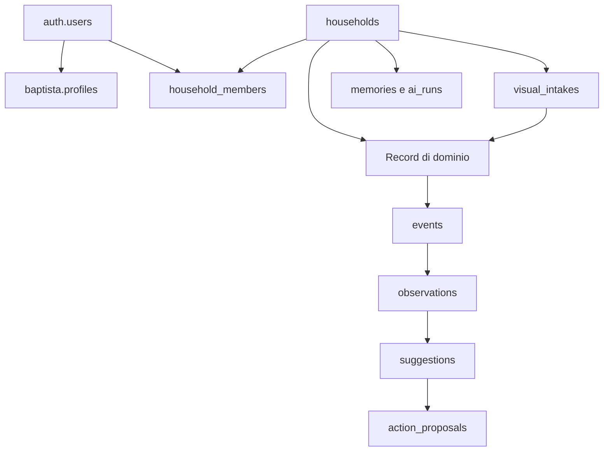

# DATABASE — Contratti relazionali

Fonte di dettaglio per modello dati; [SECURITY](SECURITY.md) possiede le policy, [AGENT](AGENT.md) i lifecycle AI e [VISUAL_INTAKE](VISUAL_INTAKE.md) le bozze immagini. Tutti i nomi sotto appartengono a baptista, salvo infrastruttura esplicitamente qualificata.

## Isolamento e migrazioni

public è GuideApp. Nessuna FK, view o funzione di dominio Baptista dipende da public. auth.users fornisce l'identità; storage.objects e bucket sono infrastruttura. Non spostare estensioni o oggetti esistenti per soddisfare una convenzione. pgvector può essere installata nello schema infrastrutturale già scelto dal progetto: la tabella memories e le funzioni Baptista restano baptista.

Esposizione Data API richiede aggiunta di baptista agli schemi esposti e grants minimi. Configurare esplicitamente schema nei client e qualificare SQL; non copiare i grants ampi dell'esempio ufficiale. Conservare le impostazioni e grants GuideApp. Nessuna migrazione remota durante produzione dei documenti.

Migrazioni incrementalmente versionate, create attraverso CLI verificata, testate su DB isolato con rappresentazione dello schema condiviso. Non resettare il progetto Supabase condiviso. Inventariare storia remota prima di collegare il repository; un nuovo repo non deve assumere che la storia migrazioni del progetto sia vuota. Generare/applicare solo cambiamenti Baptista ed eccezioni infrastrutturali nominate. Prima di applicare remote produrre diff, backup/recupero e verifica di assenza di cambiamenti public.

## Convenzioni comuni

UUID per PK; timestamptz UTC per istanti; date per scadenze civili e giorni abitudine. Household contiene timezone IANA. Importi numeric in valuta ISO, quantità numeric non float, vincoli non negativi dove appropriato. DB genera created_at/updated_at; record modificabili hanno version integer per concorrenza. Stringhe di stato con CHECK consentono evoluzione senza enum prematuri.

Campi comuni ai record utente: household_id NOT NULL, owner_user_id, created_by, visibility private/household/selected_members, id e timestamp. FK composite (household_id, parent_id) impediscono riferimenti a parent di un'altra household. Membership storica resta presente con stato revoked, evitando cascata accidentale di record privati. L'autore può diventare NULL dopo cancellazione identità; il contenuto privato non diventa condiviso quando manca il proprietario. Per cancellazione utente prevedere procedura di rimozione/anonymizzazione, non una cascata indiscriminata dall'Auth condivisa.

## Mappa concettuale

## Tabelle e introduzione

Fase 01 crea soltanto households, household_members e profiles con fondazioni RLS fail-closed e helper strettamente necessari. Le altre tabelle sono contratti da introdurre nelle fasi proprietarie, con policy prima dell'esposizione. «Database» non significa implementare oggi l'intera roadmap.

| Tabella | Campi specifici e vincoli minimi | Fase |
| --- | --- | --- |
| households | name, timezone, created_by; cancellazione attraverso procedura controllata | 01 |
| household_members | household_id, user_id, role owner/member, state pending/active/revoked; unique household/user | 01 |
| profiles | user_id PK FK auth.users, display_name, avatar_path; dati personali self-only | 01 |
| calendar_events | title, starts_at, ends_at, all_day, start_date/end_date per all-day; fine dopo inizio | 03 |
| tasks | title, status open/completed, due_date, completed_at; consistenza status/time | 03 |
| notes | title, body, kind note/list; checklist semplice validata JSONB, niente editor collaborativo | 03 |
| goals | category_id nullable → categories (on delete set null), title, start_value >=0, target_value >0 e ≠ start_value, current_value >=0, unit, target_date; obiettivi crescenti o decrescenti (es. 85 → 70 kg); progresso derivato `goal_percent` = (current − start)/(target − start) limitato a 0–100, nessuna doppia fonte percentuale | 03 |
| categories | owner_user_id nullable (null = sistema), name 1..40 unico per proprietario (case-insensitive), color `#rrggbb`; visibili: sistema + proprie + quelle usate da record leggibili; assegnabili solo sistema o proprie (trigger) | 03 (D24) |
| habits | category_id nullable → categories (on delete set null), title, target_per_week 1..7, active, starts_on; settimana lunedì-domenica timezone household | 03 |
| habit_entries | habit_id, performed_on date; unique habit/day nel prototipo, una registrazione al giorno | 03 |
| events | event_type, schema_version, source_type/id, actor, audience, payload, occurred_at, idempotency_key | 03 |
| observations | type, title, description, source_type/id, detector_version, dedupe_key, componenti ranking, priority_score, audience, state, valid_until | 03 |
| food_items | product_name, brand, barcode, category, quantity, unit, purchased_on/opened_on, explicit_expires_on/estimated_expires_on (la stima richiede estimate_basis), storage, status, closed_at (da trigger), confidence; nutrizione per 100 g kcal/protein/carbs/fat + nutrition_source manual/openfoodfacts | 04 (D25) |
| notes kind `recipe` | ricetta = checklist ingredienti + body libero; nessuna tabella separata | 04 (D25) |
| meals | title, notes, items JSONB validato (`valid_meal_items`: name, grams, kcal_100g obbligatori, macro opzionali); totali derivati in `lib/nutrition.ts` | 04 (D25) |
| diet_entries | sempre `private` (CHECK); eaten_on, slot breakfast/lunch/dinner/snack, label, grams, kcal, protein_g/carbs_g/fat_g (snapshot), meal_id nullable (on delete set null della sola colonna) | 04 (D25) |
| profiles.kcal_target | obiettivo calorico personale 800–6000, self-only | 04 (D25) |
| expense_categories | household_id, name, color, optional parent; unique household/lower(name); bootstrap idempotente `ensure_expense_categories` (invoker, RLS membro) | 04 |
| expenses | merchant e/o description, occurred_on, currency ISO, subtotal/tax/discount/total, payment_method, category_id e goal_id (FK composite, set null della sola colonna), receipt_intake_id unique nullable (FK quando esisterà visual_intakes), notes | 04 |
| expense_items | expense_id (FK composita cascade), position, raw_description, description, quantity, unit_price, line_total (negativo ammesso: sconti), category_id, confidence; RLS ereditata dalla spesa | 04 |
| budgets | household, category_id nullable (null = totale), currency, monthly_amount > 0; unico per household/categoria/valuta; condivisi con la casa | 04 (D26) |
| finance_goals | progetti di spesa: title, currency, target_date, estimate_lines JSONB validato, initial_estimate (fissato all'inserimento, non scrivibile), status active/completed/archived, visibilità | 04 (D26) |
| watchlist_items | per utente (non per household): symbol in formato TradingView validato, label, position; massimo 30 | 04 (D26) |
| wardrobe_items | original_path, processed_path, type/subtype, primary_color, attributes JSONB, tags, confidence; `acquisition` unknown/purchased/gift/owned_before + `expense_id` (FK composita, set null della colonna; la spesa collegata deve essere leggibile da chi collega, trigger) | 04 / 04.1 (D30) |
| shopping_items | Lista della spesa unica per casa, `visibility = 'household'` (CHECK); kind food/other, name + `name_key` generato (`baptista.name_key`: minuscole, accenti italiani, spazi), quantity, unit, dati OFF per il cibo (brand, barcode, category, nutrizione per 100 g), storage obbligatorio per food; status open → stocked (food) / done (other) / removed; `stocked` raggiungibile solo dalla procedura (trigger su `current_user`), food_item_id, stock_batch_id, stocked_at, expense_id | 04.1 (D30) |
| pantry_staples | prodotti abituali della casa: name + name_key unico per casa, barcode, status staple/declined (il «No» resta), created_by | 04.1 (D30) |
| goals.habit_id | C9: FK composita → habits (set null); progresso = registrazioni dell'abitudine dal giorno di creazione al target_date; un obiettivo condiviso non può seguire un'abitudine privata; progresso manuale rifiutato (`linked_goal`) | 04.1 (D30) |
| baptista_presentations | memoria di presentazione per spettatore (self-only): key `obs:<dedupe_key>` o `daily:<data>`, observation_id, first/last_shown_at, show_count (al massimo una volta ogni 4 h), last_variant, outcome shown/answered/acted/snoozed/dismissed/failed, snoozed_until, script_step, result_text; scrittura solo via `record_presentation` | 04.1 (D30) |
| visual_intakes | purpose receipt/wardrobe, uploader, paths, state, proposal JSONB validato/versionato, expires_at, confirmed_entity_id | 04 |
| ai_runs | purpose, provider/model, mode, location, fallback, token/cost/latency/tool counts, success/error, correlation_id | 04 minimo, 05 completo |
| suggestions | observation_ids, type, content, audience, state proposed/accepted/dismissed/expired, feedback_at | 05 |
| action_proposals | tool_name, validated_payload, author, audience, expected_version, expires_at, idempotency_key, state, executed_entity_id | 05 |
| notifications | recipient_user_id, suggestion_id nullable, text minimale, read_at; solo in-app nel prototipo | 05 |
| memories | type factual/behavioural/episodic, text, provenance, audience, confidence, embedding nullable, embedding_model/dimension/version | 05 |
| ai_settings | household policy, user preference nullable, mode, fallback_consent, budget; policy household più restrittiva prevale | 04 minimo, 05 UI completa |

Supporto tecnico aggiunto in fase 03: `observation_refreshes` (household_id, refreshed_at) per throttling/lease del refresh detector; nessun accesso client.

Procedure di fase 04.1 (una transazione per gesto composto): `add_shopping_item` (invoker; stessa voce aperta per barcode o name_key → somma la quantità), `stock_shopping_items(casa, ids, bulk)` (definer con membership riverificata; crea i `food_items` della casa con `purchased_on` = oggi locale, chiude le righe, evento `shopping.items_stocked` con `bulk`; doppio tocco = nulla), `unstock_shopping_items` (annulla tutto o niente, solo se ogni alimento creato è ancora alla versione 1 e disponibile), `register_shopping_expense` (C1, definer: spesa in «Spesa alimentare» con totale digitato e righe solo per gli importi digitati; collega le righe del lotto), `register_wardrobe_purchase` (invoker, versione del capo; con prezzo crea una spesa in «Abbigliamento» con la visibilità scelta, senza prezzo nessuna spesa; replay = stessa spesa), `mark_wardrobe_owned_before` (invoker; almeno 7 id distinti, solo capi propri `unknown` e attivi, tutto o niente), `set_pantry_staple`, `in_pantry`/`on_shopping_list` (solo detector), `habit_goal_count`, `record_presentation`.

Validatori JSONB: una chiave mancante produce NULL, quindi ogni predicato per elemento è avvolto in `coalesce(…, false)` e i numeri sono convertiti solo dopo il controllo del tipo (`json_number`). Corretto anche `valid_checklist` di fase 03, che accettava elementi senza chiavi.

Non creare tabella prodotti, outfit, dispositivi smart home, transazioni bancarie o maintenance nel prototipo. action_proposals, visual_intakes e ai_settings sono supporti necessari ai lifecycle richiesti, non nuovi domini di prodotto.

## Integrità dei domini

Calendar: eventi timed usano istanti; all-day usa date con fine esclusiva. Non simulare all-day con mezzanotte UTC. In fase 03 niente ricorrenze calendar complesse. Task due_date è un giorno locale; il detector overdue scatta il giorno successivo.

Goal: il punto di partenza è esplicito; il valore attuale di un nuovo obiettivo parte dal punto di partenza, quindi un obiettivo appena creato non risulta mai completato. Numeri digitati in formato italiano (`85,5`, `1.250`).

Habit: conteggio per settimana locale, denominatore target, una entry per giorno; percentuale espositiva limitata al 100% e conteggio reale preservato. Missed significa settimana terminata sotto target; entro la settimana indicare rimanenti. Goal progresso calcolato da current/target, non scritto dal modello.

Food: storage fridge/freezer/pantry; status available/opened/consumed/discarded. quantity non negativa; consumed/discarded sono terminali salvo correzione esplicita. Data esplicita prevale sulla stima, con provenienza conservata. Non calcolare automaticamente sicurezza alimentare o reset della scadenza spostando in freezer.

Finance: total è il totale confermato del documento, righe sono dettaglio. Discrepanze da arrotondamento, sconti o imposte richiedono avviso di revisione, non uguaglianza forzata. Non sommare valute diverse. Ogni query dettagliata applica visibilità della spesa parent; le righe non hanno pubblico autonomo.

## Eventi e osservazioni

Mutazione dominio ed evento nella stessa transazione: procedure di dominio con sessione verificata, privilegi minimi ed eventuale elevazione limitata alla persistenza evento. Client non inserisce eventi autonomamente. Evitare emissione doppia tramite trigger e servizio. **Implementazione (fase 03, D17):** l'unico emettitore è un trigger AFTER `security definer` sulle tabelle di dominio (`tg_emit_events` → `emit_event`, idempotency_key univoca); i servizi applicativi non emettono eventi. Le scritture client passano da RLS + grant di colonna; i campi identità sono impostati da trigger dalla sessione. Eventi append-oriented con payload minimo, non snapshot privati completi; cancellazioni/privacy possono redigere o eliminare payload identificanti tramite procedura amministrativa.

Eventi: calendar.event_created, task.completed, habit.completed, goal.progress_changed, food.item_added/item_consumed/item_discarded, receipt.imported, wardrobe.item_added; fase 04.1: shopping.items_stocked (payload bulk/count), shopping.item_added/item_done/item_removed, finance.expense_added, wardrobe.acquisition_set, pantry.staple_changed. habit.missed e food.expiry_approaching sono eventi sintetici dei detector, deduplicati per fonte/finestra/versione.

Detector rileggono stato autorizzato, processano eventi almeno una volta e sono idempotenti. Deduplica osservazioni con unique household/audience/dedupe_key, non solo fonte. Stato active/dismissed/resolved/expired; il dismissal dura per quella situazione/finestra, non sopprime per sempre la fonte. Consumo alimento o cambio scadenza risolve/rivaluta; record eliminato rende il derivato non leggibile. Nessuna ricorsione evento-detector senza filtro tipo.

Baseline esecuzione: refresh server on-demand per household e utente con lease/lock breve e limiti (fase 04.1: il throttling di 30 s non si applica se dall'ultimo refresh sono arrivati eventi nuovi, così la domanda nata da un gesto compare subito); nessun daemon permanente Vercel. Fase 05 può aggiungere scheduler autenticato se compatibile col deployment, con batching e idempotenza. Detector temporali non dipendono soltanto da eventi di scrittura.

## Indici e volumi

Indicizzare membership user/state/household; domini household + colonna ordinamento; figli household/parent; events household/occurred_at; observations household/audience/state/priority; intakes uploader/state; proposals author/state. Indici parziali per record attivi se giustificati dalle query. Limit e cursori per tutti gli elenchi; nessun indice vettoriale di grande scala senza misure.

## Memoria e portabilità

Memorie implementate in 05 con pgvector, embedding nullable per AI off/capacità assente. Una colonna dimensionata alla configurazione embedding adottata; cambio modello o dimensione richiede migration/reembedding, mai confronto fra spazi incompatibili. Filtrare household/visibilità prima di ranking semantico e garantire lo stesso filtro nella RPC. Ricerca testuale è fallback privacy-safe.

Trasferimento futuro: esportare baptista con FK verso Auth da rimappare, membership e identificatori utenti; copiare bucket privati e ricreare policy; aggiornare URL/chiavi server, callback Auth e scheduler. Sessioni/token Auth e impostazioni infrastrutturali non si trasferiscono mediante semplice dump. Nessun accesso applicativo hardcoded al project ref. Verificare conteggi, checksum oggetti e test isolamento prima del cutover.

Fonti: [custom schemas](https://supabase.com/docs/guides/api/using-custom-schemas), [RLS](https://supabase.com/docs/guides/database/postgres/row-level-security). Questi link sono riferimenti tecnici, non autorizzazione a cambiare il progetto remoto.
